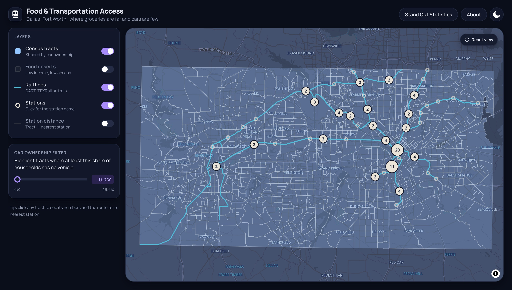

# DFW Food & Transportation Access Map

An interactive map of the Dallas–Fort Worth area that asks one question:
**for families without a car, does the rail system actually get them to the grocery store?**



Live site: https://dfw-food-and-transportation-dashboard.vercel.app/

## Why

In Texas, getting to the grocery store usually means getting in a car. Dallas has the most extensive
rail system in the state, but living near a train line doesn't guarantee being able to reach a
supermarket. Feeding America estimates that 19.2% of Dallas County residents, about 503,000 people,
were food insecure in 2024, including more than 1 in 4 children. Nationally, 19% of adults report
transportation insecurity, more than report food insecurity, and the two often go together.

This map puts three things side by side for every census tract: how many households have no vehicle,
whether the tract is a food desert, and how far it is from the nearest rail station.

## Features

- **Car ownership filter:** drag the slider or type a percentage to highlight tracts where at least
  that share of households has no vehicle
- **Food deserts:** USDA low-income, low-access tracts (1 mile urban / 10 miles rural)
- **Rail lines and stations:** nearby stations group together when zoomed out and split apart as you zoom in
- **Tract details:** click any tract to see households, % without a car, median income, people more
  than ½ mile from a grocery store, and the route to its nearest station
- **Stand out statistics:** region-wide numbers comparing food-desert tracts with everything else
- **Light and dark mode**, layer toggles, and a reset-view button

## Built with

[SvelteKit](https://svelte.dev/docs/kit) (Svelte 5) · [Tailwind CSS 4](https://tailwindcss.com) ·
[MapLibre GL JS](https://maplibre.org) · [OpenFreeMap](https://openfreemap.org) basemaps ·
data hosted on ArcGIS Online

## Run it locally

Requires Node.js 20.19+ or 22.12+ (what Vite needs).

```sh
npm install
npm run dev
```

Then open http://localhost:5173. No API keys or environment variables are needed: all data comes
from public ArcGIS feature services.

## Project structure

```
src/
├── lib/
│   ├── components/
│   │   ├── Dashboard.svelte   
│   │   ├── Map.svelte         
│   │   └── About.svelte       
│   └── stats.js               
└── routes/
    ├── +page.svelte
    └── layout.css            
static/                        
```

## Data

| Field | Meaning | Source |
| --- | --- | --- |
| `B08201_001E`, `B08201_002E` | Household / households with no vehicle | ACS 5-year, table B08201 |
| `B08201_calc_pctNoVehE` | % of households with no vehicle | Derived from B08201 |
| `B19049_001E` | Median household income | ACS 5-year, table B19049 |
| `DD_SRAM_LILATracts_1And10` | Low income & low access (1 mi urban / 10 mi rural) | USDA Food Access Research Atlas |
| `DD_SRAM_lapophalf` | Population more than ½ mile from a supermarket | USDA Food Access Research Atlas |
| `Total_Miles` | Distance to the nearest rail station | Derived |

Store data uses the 2025 USDA SNAP retailer list rather than the general store dataset, which was
last updated in 2019, before COVID.

## Sources

- Feeding America, [Map the Meal Gap](https://map.feedingamerica.org/) (2024 data)
- Arnold (2025), [Public Transportation Access and Food Insecurity](https://onlinelibrary.wiley.com/doi/full/10.1111/jors.70010), *Journal of Regional Science*
- U.S. Hunger (2022), [Transportation and food insecurity](https://ushunger.org/blog/transportation-food-insecurity/)
- Mcity, University of Michigan (2025), [Lack of regular transportation as great a hardship as food, medical care and housing](https://mcity.umich.edu/lack-of-regular-transportation-as-great-a-hardship-as-reliable-access-to-food-medical-care-housing-and-more/)
- U.S. Census Bureau, American Community Survey 5-year estimates
- USDA Economic Research Service, [Food Access Research Atlas](https://www.ers.usda.gov/data-products/food-access-research-atlas/)
- USDA Food and Nutrition Service, [SNAP Retailer data](https://www.fns.usda.gov/snap/retailer/data)

## Credits

Basemap © [OpenFreeMap](https://openfreemap.org), © [OpenStreetMap](https://www.openstreetmap.org/copyright) contributors.
Icons from Flaticon: [moon icons by Good Ware](https://www.flaticon.com/free-icons/moon),
[train stop icons by andinur](https://www.flaticon.com/free-icons/train-stop).
